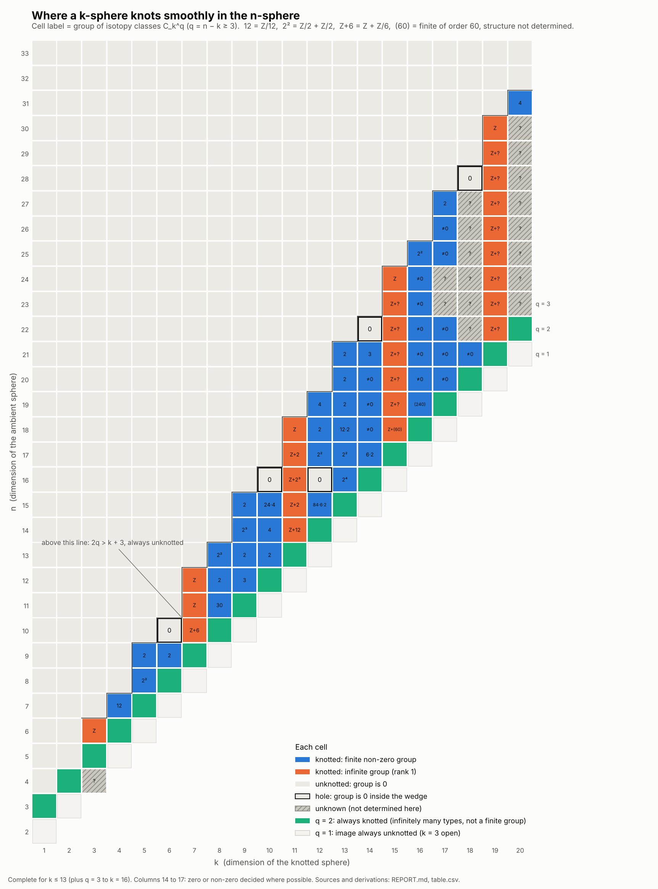
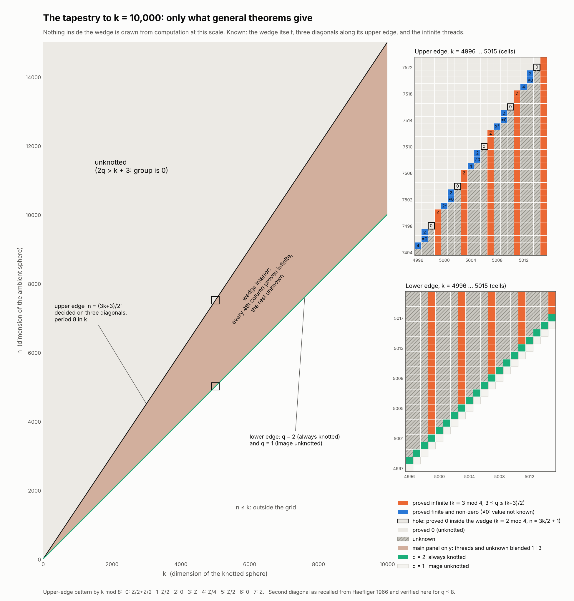

# The Haefliger knot tapestry

Convention: `k` is the dimension of the knotted sphere, `n` the ambient dimension,
`q = n - k` the codimension. `C_k^q` is the group of isotopy classes of smooth
embeddings S^k → S^(k+q), for q ≥ 3.

## What the picture shows

**The knotted region is not a solid wedge. It has holes, of two kinds.**

1. **A regular row of holes one step inside the upper edge.** Whenever k ≡ 2 mod 4,
   the cell just under the edge is 0: `C_{4s+2}^{2s+2} = 0`, i.e. (k, n) = (6, 10),
   (10, 16), (14, 22), (18, 28), … One hole every four columns, for ever. This is
   Haefliger's 1966 result; I re-derived it here for q = 4, 6, 8.
2. **At least one hole well inside the wedge: `C_12^4 = 0`,** the 12-sphere in the
   16-sphere. It sits three cells below the top of its column and all its neighbours
   are non-zero: Z/84 + Z/6 + Z/2 (codimension 3) and Z/2 + Z/2 (codimension 5) for
   the same k; Z + Z/2 and Z/2 + Z/2 for k = 11 and k = 13 in the same codimension.
   I found it by computation and confirmed it with two different exact sequences. I
   could not check it against a published table (see "Sources"). One instance is not
   a pattern, so I make no claim about where the next interior hole is.

Apart from these, every cell in the determined range (all of k ≤ 13) is knotted.
In particular the two cells you suspected were empty are not: **`C_5^3 = Z/2 + Z/2`
and `C_6^3 = Z/2`.**

**No further holes up to k = 16.** After the first pass I extended the search,
deciding only zero or non-zero. Columns 14, 15 and 16 are now fully decided and
contain no hole other than the edge one at (14, 22). Column 17 has two undecided
cells (q = 6, 7) and column 18 has six. Along the way one new value turned up:
`C_14^7 = Z/3`, a group of odd order four steps in from the edge. And the third
diagonal (k = 2q − 1) never vanishes for any q, so the only holes within three
steps of the edge are the known ones. Details: "Hole search beyond k = 13" below.

**Periodic structure that is proved at every scale:**

- **Threads.** The group is infinite exactly on the columns k ≡ 3 mod 4, from q = 3
  up to the edge. One column in four, all the way to k = 10,000 and beyond.
- **The upper edge has period 8 in k.** Reading the top non-zero cell of each
  column: k mod 8 = 0: Z/2 + Z/2, 1: Z/2, 2: hole, 3: Z, 4: Z/4, 5: Z/2, 6: hole, 7: Z.
  (The single exception is the start: k = 4 gives Z/12.)

**What colouring by size shows (k ≤ 13 only, so a small sample):**

- The large groups and almost all the odd torsion live in codimension 3, the bottom
  diagonal. Its values run Z, 12, 4, 2, Z+6, 30, 3, 2, Z+12, 1008, 16, 12, Z+60, 240
  for k = 3 … 16. Only two cells outside codimension 3 have odd torsion
  (`C_10^5` and `C_13^5`, both a single Z/3).
- Groups shrink fast as the codimension grows. For q ≥ 6 nothing larger than Z/4, or
  Z + Z/2 on a thread, occurs.
- Only the primes 2, 3, 5 and 7 appear. 2 is nearly everywhere; 7 appears once.

**How much is known.** Every group for k ≤ 13 (36 cells inside the wedge) plus
codimension 3 out to k = 16; zero or non-zero for all of k ≤ 16 and part of k = 17, 18.
Beyond that, only the wedge, the threads and three diagonals along the upper edge. The zoomed-out picture is therefore mostly "unknown" by design.

## The pictures

| file | what it shows |
|---|---|
| `tapestry_knotted.png` | knotted / unknotted / unknown, with the group written in each cell |
| `tapestry_order.png` | log of the torsion order, infinite groups as orange threads |
| `tapestry_primes.png` | one panel per prime (2, 3, 5, 7): where it divides the torsion order |
| `tapestry_zoomout_10000.png` | k up to 10,000, theorems only, with two magnified insets |
| `tapestry.html` | zoomable version with all three layers; hover a cell for value, status, source |

There is no conjectural layer. I did not find a heuristic I trusted enough to draw.






## The determined block

Rows are codimension q, columns are k. `·` = 0 by the unknotting theorem, **0** = a
hole, `?` = unknown. 12 = Z/12, 2² = Z/2 + Z/2, Z+6 = Z + Z/6, (60) = a finite group
of order 60 whose structure I did not determine.

| q \ k | 3 | 4 | 5 | 6 | 7 | 8 | 9 | 10 | 11 | 12 | 13 | 14 | 15 | 16 |
|---|---|---|---|---|---|---|---|---|---|---|---|---|---|---|
| 8 | · | · | · | · | · | · | · | · | · | · | 2 | **0** | Z+? | ? |
| 7 | · | · | · | · | · | · | · | · | Z | 4 | 2 | ? | Z+? | ? |
| 6 | · | · | · | · | · | · | 2 | **0** | Z+2 | 2 | 2 | ? | Z+? | ? |
| 5 | · | · | · | · | Z | 2² | 2³ | 24·4 | Z+2³ | 2² | 12·2 | ? | Z+? | ? |
| 4 | · | · | 2 | **0** | Z | 2 | 2 | 4 | Z+2 | **0** | 2² | ? | Z+? | ? |
| 3 | Z | 12 | 2² | 2 | Z+6 | 30 | 3 | 2 | Z+12 | 84·6·2 | 2⁴ | 6·2 | Z+(60) | (240) |

`table.csv` has one row per cell for k ≤ 64, n ≤ 100, with status, source and an
`evidence` column saying how each value was checked.

## Your starting claims, one by one

| claim | verdict |
|---|---|
| q = 1: no knots | **Needs two qualifications.** The image always bounds a disc for k ≠ 3. For k = 3 this is the smooth Schoenflies problem in S^4, which is open. And as parametrised embeddings (the convention in which C_k^q is a group) the classes for k ≥ 4 are in bijection with the exotic spheres Θ_{k+1}: 28 classes for k = 6, for example. They differ only by an exotic reparametrisation of the same round sphere. |
| q = 2: always knotted | Correct for every k ≥ 1. The knot types are infinite in number and do not form a finitely generated group. |
| q ≥ 3: finitely generated abelian, zero when 2q > k + 3 | Correct. |
| edge k = 2q − 3: Z for q odd, Z/2 for q even | Correct. Re-derived here for every q ≤ 8; the general argument is sketched in `DERIVATIONS.md`. |
| `C_4^3 = Z/12` | Correct. |
| `C_5^3 = 0` | **Wrong.** It is Z/2 + Z/2. The order 4 was derived three ways; it is not Z/4 because the map `C_5^3 → C_5^4 = Z/2` splits off the other factor. The Manifold Atlas lists this group as unknown. |
| `C_6^3 = 0` | **Wrong.** It is Z/2. |
| `C_6^4 = 0` | Correct. It is the first of the second-line holes. |
| infinite exactly when k = 4j − 1 and 3 ≤ q ≤ 2j + 1 | Correct (rank 1 in that case). |
| `C_k^q ≅ π_{k+1}(G; SO, G_q)` | Correct, for q ≥ 3. |
| "so the values reduce to homotopy groups of spheres and rotation groups" | **Too optimistic.** The groups alone are not enough. You also need the maps between them (the unstable J-homomorphism and iterated suspensions) and in places secondary information (Toda brackets). That is why the published results stop where they do. |

Two further things I had expected and found otherwise:

- `C_7^4 = Z`, with no torsion. The inclusion S^11 ⊂ S^12 induces an isomorphism
  `C_7^4 → C_7^5 = Z`. The Manifold Atlas lists this group as unknown.
- `C_9^3 = Z/3` consists entirely of reparametrisations: all three classes have the
  round S^9 as image and differ by the exotic 10-spheres of order 3.

## Is `C_12^4 = 0` already known?

I could not find it stated anywhere, and I could not open the papers that would
settle it. What search turned up:

- Published values cover the first two diagonals completely (Haefliger 1966, 8.15)
  and the 2-primary part on a few more diagonals (Milgram 1972, Theorem F).
  `C_12^4` is on the eighth diagonal with q only 4, well outside the range such
  methods reach.
- The Manifold Atlas names `C_5^3` and `C_7^4` as the lowest-dimensional unknown
  groups. `C_12^4` is further out, so it is presumably also unrecorded.
- A 2021 paper (Gauniyal) says no computations have been done since Milgram.

So it is probably not in the literature. That is weaker than "new": the value
follows in a few lines from Haefliger's 1966 exact sequence and Toda's 1962 tables,
so anyone who sat down with both would get it. The same caution applies in reverse.
The Atlas lists two groups as unknown that I computed here (`C_5^3`, `C_7^4`). Either
nobody wrote them down, or I have made an error I cannot see. I believe the former,
because the arguments are short and were checked several ways, but only the sources
can confirm it.

## Hole search beyond k = 13

A hole needs two maps to be bijective at once, so most cells can be ruled out with
far less than the full group. `DERIVATIONS.md` has the argument for each cell.

| q \ k | 14 | 15 | 16 | 17 | 18 |
|---|---|---|---|---|---|
| 10 | · | · | · | 2 | **0** |
| 9 | · | Z | 2² | ≠0 | ? |
| 8 | **0** | Z+? | ≠0 | ≠0 | ? |
| 7 | 3 | Z+? | ≠0 | ? | ? |
| 6 | ≠0 | Z+? | ≠0 | ? | ? |
| 5 | ≠0 | Z+? | ≠0 | ≠0 | ? |
| 4 | ≠0 | Z+? | ≠0 | ≠0 | ? |
| 3 | 6·2 | Z+(60) | (240) | ≠0 | ≠0 |

`≠0` = shown non-zero, group not determined. The two holes in this range are the
edge holes already known.

**What it costs.** The bookkeeping is nothing: every script here runs in under a
second. The cost is the input. Each cell needs a handful of named facts about
unstable homotopy groups of spheres and of rotation groups: which elements exist,
their orders, what they suspend to, and what the J-homomorphism does to them.

- With Toda's book, the Mimura–Toda papers and Kachi's tables for SO(n) open, I
  would expect to finish every group to about k = 17 or 18 (roughly 40 more cells)
  in one session, and decide zero or non-zero somewhat further.
- Beyond stem 19 or so the inputs thin out. The unstable groups are tabulated with
  generators only in patches (to about stem 30 for small spheres at the prime 2),
  and each further column is closer to research than to lookup.
- Tonight the limit was my recall of those tables, which is why column 17 stops
  with two cells open.

## Method

Haefliger's theorem identifies `C_k^q` with the triad homotopy group
`π_{k+1}(G; SO, G_q)`. A triad group sits in two long exact sequences, and comparing
codimension q with q + 1 gives a third. Writing m = q − 1 and F_m for the based
self-equivalences of S^m (so `π_i(F_m) = π_{i+m}(S^m)`):

- **(A′)** `π_{k+1}(SO, SO_m) → π_{k+1}(F, F_m) → C_k^q → π_k(SO, SO_m) → π_k(F, F_m)`
- **(B)** `π_{k+1}(F_m, SO_m) → π_{k+1}(G/O) → C_k^q → π_k(F_m, SO_m) → π_k(G/O)`
- **(L)** `C_{k+1}^{q+1} → π_k(W_m) → C_k^q → C_k^{q+1} → π_{k−1}(W_m)`, where W_m is the
  fibre of the (m+1)-fold suspension S^m → Ω^{m+1} S^{2m+1}.

The inputs are the unstable homotopy groups of spheres with Toda's generators, the
stable stems with the image of J, the homotopy groups of SO(3), SO(4), Sp(2) = Spin(5)
and SU(4) = Spin(6), and how the J-homomorphism and suspensions act on generators.
`DERIVATIONS.md` gives the computation for every cell.

Each cell was computed with (A′) or (B), then checked two ways:

1. **Against known values first**, before trusting it further: `C_3^3 = Z`,
   `C_4^3 = Z/12`, `C_5^4 = Z/2`, `C_6^4 = 0`, `C_7^5 = Z`, `C_8^5 = Z/2 + Z/2`,
   `C_9^6 = Z/2`, `C_10^6 = 0`, `C_11^7 = Z`, `C_12^7 = Z/4`, `C_13^8 = Z/2`,
   `C_14^8 = 0`. All reproduced.
2. **Against (L)**, which uses different input (suspensions between unstable spheres
   rather than the J-homomorphism and stable stems). `check_layers.py` verifies that
   the orders in the block fit together exactly along (L) for every pair of adjacent
   codimensions; it finds exactly one consistent assignment in each case. Deliberately
   wrong values, including the starting claim `C_5^3 = 0`, are rejected by it. It does
   not detect every possible error (it would accept `C_12^4 = Z/2`, for instance), so
   it is a cross-check, not a proof.

One mistake was caught this way and is worth knowing about. (L) as stated is valid
at odd primes only when m is odd. An early pass applied it with m = 2 at the prime 3
and produced `C_7^3 = Z + Z/2` and a Z/9 inside `C_12^3`. Both were wrong;
(A′) gives `Z + Z/6` and `Z/84 + Z/6 + Z/2`.

## Sources

**No primary source could be opened tonight.** The session's network policy allows
only package registries, so the AMS, Project Euclid, JSTOR, arXiv, the Manifold Atlas,
Wikipedia and Ranicki's archive were all refused. Web search still worked but returns
snippets, not tables. The consequences:

- **Nothing in `table.csv` has the status `from-published-table`.** Milgram's 1972
  table was not seen, so there is no cross-check of a table value against two sources,
  and no disagreement between sources to record.
- Confirmed from search snippets: the triad isomorphism (Haefliger 1966, as quoted in
  Gauniyal, arXiv:2110.13954); `C_k^q = 0` for k < 2q − 3; the finiteness and rank
  statement (Manifold Atlas); `C_4^3 = Z/12`; `C_3^3 = Z`; `C_{4j−1}^{2j+1} = Z`;
  that the Manifold Atlas has a Haefliger–Milgram table and names E^8(S^5) and
  E^11(S^7) as the lowest-dimensional unknown groups; the S^3 row of the table of
  homotopy groups of spheres up to π_15.
- Recalled and not re-read: the second-line theorem (`C_{2q−2}^q` is 0 for q even,
  Z/4 for q ≡ 3 mod 4 with q ≥ 7, Z/2 + Z/2 for q ≡ 1 mod 4); Toda's generators and
  relations; the Mimura–Toda groups of Sp(2) and SU(4); the Kervaire–Milnor orders.

Works the values rest on: Haefliger, *Knotted (4k−1)-spheres in 6k-space* (1962) and
*Differentiable embeddings of S^n in S^{n+q} for q > 2* (1966); Levine, *A
classification of differentiable knots* (1965); Toda, *Composition methods in homotopy
groups of spheres* (1962); Mimura–Toda on Sp(2) and SU(4) (1963–64); Kervaire–Milnor
(1963); Milgram, *On the Haefliger knot groups* (1972), not seen.

## What is verified and what is not

| tier | cells | basis |
|---|---|---|
| Solid | the wedge; the threads; the edge; `C_4^3`; `C_5^3 = Z/2 + Z/2`; `C_6^3 = Z/2`; `C_6^4 = C_10^6 = C_14^8 = 0` | theorem confirmed in a snippet, or two exact sequences from low-dimensional classical input |
| Computed here, cross-checked | the rest of the block k ≤ 13, including `C_12^4 = 0` and `C_7^4 = Z` | (A′) or (B), consistent with (L); input recalled from the standard tables |
| Computed here, one extra step | `C_9^4`, `C_10^4`, the 3-part of `C_9^5`, `C_10^5` | uses β₁ = ⟨α₁, α₁, α₁⟩. If that step failed, `C_9^4` and `C_10^4` would each gain a Z/3 and nothing else would change |
| Computed here, one extra step | `C_13^4`, `C_13^5` | a secondary term is shown to vanish using π₁₃(Sp(2)) = Z/4 + Z/2. If that failed the orders would be 2 and 12 instead of 4 and 24. The (L) check cannot tell these apart. Both cells are non-zero either way |
| Order certain, structure argued | `C_13^3`, `C_14^3`, `C_9^5`; the Z/4 in `C_13^5` | splitting by a Toda-bracket argument, or one of Toda's relations |
| Order only | `C_15^3`, `C_16^3` | group structure not determined |
| Non-zero only | `C_14^q` (q = 4, 5, 6), `C_16^q` (q = 4 … 8), `C_17^q` (q = 3, 4, 5, 8), `C_18^3`, and the third diagonal for all odd q ≥ 9 | order counts and exact sequences; `C_16^7`, `C_16^8`, `C_17^8` and the third diagonal also depend on the recalled second-line theorem |
| Recalled theorem | second line for q ≥ 9 | Haefliger 1966, not re-read; verified here for q ≤ 8 |
| Unknown | everything else | left blank |

The weakest link is that the input tables were recalled, not re-read. The safeguards
were the known-value tests and the (L) consistency check. If you can allow access to
the Manifold Atlas page and Milgram's paper, the first thing to compare is his third
diagonal (k = 2q − 1) with my `C_9^5` (order 8), `C_11^6 = Z + Z/2` and
`C_13^7 = Z/2`, and then `C_12^4 = 0`.

## Reproducing

```
python3 build_table.py      # table.csv
python3 check_layers.py     # consistency of the block along (L)
python3 render.py           # three detailed PNGs
python3 render_zoomout.py   # the k ≤ 10,000 view
python3 build_html.py       # tapestry.html
```

All values live in `cells.py`; `NOTES.md` logs the decisions made along the way.
