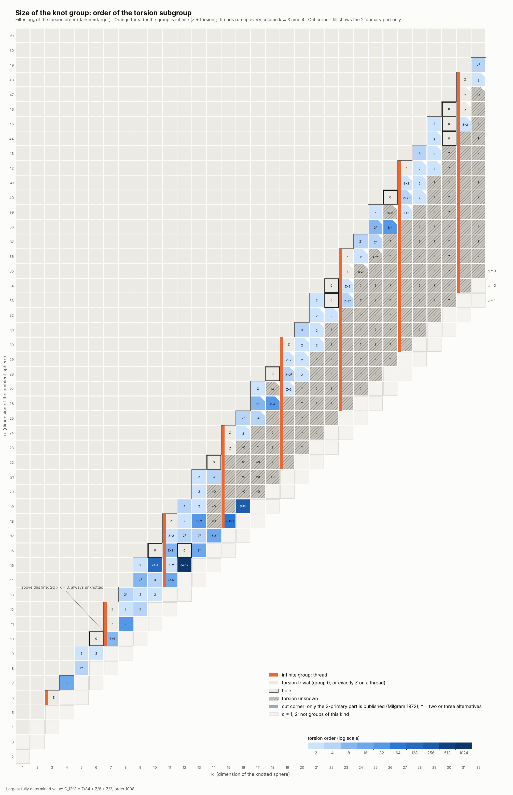
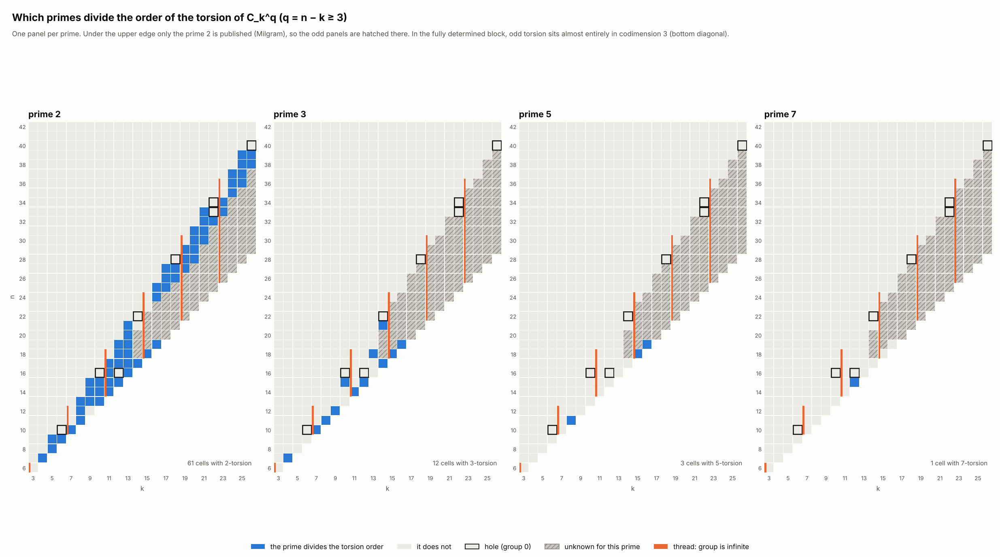

# The Haefliger knot tapestry

Convention: `k` is the dimension of the knotted sphere, `n` the ambient dimension,
`q = n - k` the codimension. `C_k^q` is the group of isotopy classes of smooth
embeddings S^k → S^(k+q), for q ≥ 3.

This is the second version. The first was written with no access to the literature.
Haefliger's 1966 paper and Milgram's 1972 paper have now been read in full, and the
input tables checked. What changed is listed under "Cross-check against the sources".

## What the picture shows

**The knotted region is not a solid wedge. Under its upper edge it has holes in
three periodic families, and there is at least one isolated hole further in.**

*The three families* (Haefliger 1966, 8.15 and Milgram 1972, Corollary G; valid for
codimension above 7, the first family for every even q ≥ 4). Within seven cells of
the upper edge, `C_k^q = 0` exactly when

| family | condition on q | position | first cases (k, n) |
|---|---|---|---|
| (a) | q even | k = 2q − 2 | (6, 10), (10, 16), (14, 22), (18, 28), … |
| (b) | q ≡ 3 mod 4 and q ≢ 1 mod 3 | k = 2q | (22, 33), (30, 45), (46, 69), … |
| (c) | q ≡ 6 mod 8 and q ≢ 0 mod 3 | k = 2q + 2 | (30, 44), (46, 68), (78, 116), … |

Read column by column, this is a simple pattern in k with period 48:

- every column k ≡ 2 mod 4 has a hole in its top cell;
- if also k ≡ 6 mod 8 and k/2 ≢ 1 mod 3, the cell below it is a hole too
  (first at k = 22);
- if also k ≡ 14 mod 16, a third cell below is a hole (first at k = 30, where
  (30, 46), (30, 45) and (30, 44) are all empty).

Where the mod 3 condition fails the cell is not empty but tiny: a group of odd order.
`C_14^7 = Z/3`, computed here, is the first example.

*The isolated hole.* `C_12^4 = 0`, the 12-sphere in the 16-sphere, computed here and
confirmed by two exact sequences. It lies outside the range of both papers. It is not
the start of a fourth family: Milgram's periodic pattern has Z/2 in the corresponding
position for codimension 12, 20, 28, …. It appears to be a low-codimension accident.

*No other holes are known.* Every other cell that has been decided is knotted: all of
k ≤ 16, and everything within seven cells of the upper edge.

**Other periodic structure:**

- **Threads.** The group is infinite exactly on the columns k ≡ 3 mod 4.
- **Period 8 along the edge.** For codimension above 7 the 2-primary part of the
  first seven groups under the edge depends only on q mod 8 (Milgram, Theorem F).
  The largest published 2-groups (Z/16 + Z/8, Z/8 + Z/4) sit three to five cells
  below the edge.

**What colouring by size shows** (fully determined block only, k ≤ 13):

- The large groups and almost all the odd torsion are in codimension 3. Its values
  run Z, 12, 4, 2, Z+6, 30, 3, 2, Z+12, 1008, 16, 12, Z+60, 240 for k = 3 … 16.
- Groups shrink fast as the codimension grows.
- Only the primes 2, 3, 5 and 7 appear.

**How much is known.**

- Every group for k ≤ 13 (36 cells inside the wedge) and codimension 3 to k = 16:
  computed here.
- Zero or non-zero for all of k ≤ 16.
- For every codimension above 7: seven diagonals under the edge. The first two are
  known exactly; for the other five only the 2-primary part is published, plus
  whether the group vanishes.
- Everything else is unknown, including most of the interior beyond k = 17.

## The pictures

| file | what it shows |
|---|---|
| `tapestry_knotted.png` | knotted / unknotted / unknown to k = 32, group written in each cell |
| `tapestry_order.png` | log of the torsion order, infinite groups as orange threads |
| `tapestry_primes.png` | one panel per prime (2, 3, 5, 7) |
| `tapestry_zoomout_10000.png` | k up to 10,000, with two magnified insets |
| `tapestry.html` | zoomable version with all three layers; hover a cell for value, status, source |

A cell with a cut corner shows only the 2-primary part (that is all Milgram's table
gives). There is no conjectural layer.







## The block computed here (codimension 3 to 8)

`·` = 0 by the unknotting theorem, **0** = a hole, `?` = unknown, `≠0` = non-zero
with the group not determined. 12 = Z/12, 2² = Z/2 + Z/2, Z+6 = Z + Z/6, (60) = a
finite group of order 60 whose structure was not determined. Entries in italics are
Milgram's (2-primary part only).

| q \ k | 3 | 4 | 5 | 6 | 7 | 8 | 9 | 10 | 11 | 12 | 13 | 14 | 15 | 16 | 17 |
|---|---|---|---|---|---|---|---|---|---|---|---|---|---|---|---|
| 8 | · | · | · | · | · | · | · | · | · | · | 2 | **0** | *Z* | *2* | *2²* |
| 7 | · | · | · | · | · | · | · | · | Z | 4 | 2 | 3 | Z+? | ≠0 | ? |
| 6 | · | · | · | · | · | · | 2 | **0** | Z+2 | 2 | 2 | ≠0 | Z+? | ≠0 | ? |
| 5 | · | · | · | · | Z | 2² | 2³ | 24·4 | Z+2³ | 2² | 12·2 | ≠0 | Z+? | ≠0 | ≠0 |
| 4 | · | · | 2 | **0** | Z | 2 | 2 | 4 | Z+2 | **0** | 2² | ≠0 | Z+? | ≠0 | ≠0 |
| 3 | Z | 12 | 2² | 2 | Z+6 | 30 | 3 | 2 | Z+12 | 84·6·2 | 2⁴ | 6·2 | Z+(60) | (240) | ≠0 |

`table.csv` has one row per cell for k ≤ 64, n ≤ 100, with status, source, an
`evidence` column, the 2-primary part where that is what is known, and for the cells
computed here a comparison with Milgram's pattern.

## Your starting claims, one by one

| claim | verdict |
|---|---|
| q = 1: no knots | **Needs two qualifications.** The image always bounds a disc for k ≠ 3; k = 3 is the open smooth Schoenflies problem. As parametrised embeddings the classes for k ≥ 4 are the exotic spheres Θ_{k+1} (28 classes for k = 6). |
| q = 2: always knotted | Correct. |
| q ≥ 3: finitely generated abelian, zero when 2q > k + 3 | Correct. |
| edge k = 2q − 3: Z for q odd, Z/2 for q even | Correct (Haefliger 1966, 8.14). |
| `C_4^3 = Z/12` | Correct (Haefliger 8.15). |
| `C_5^3 = 0` | **Wrong.** It is Z/2 + Z/2. |
| `C_6^3 = 0` | **Wrong.** It is Z/2. This claim is what Milgram's Corollary G(b) would give if applied at q = 3, but his theorem is stated only for q > 7. |
| `C_6^4 = 0` | Correct (Haefliger 8.15, by direct check). |
| infinite exactly when k = 4j − 1 and 3 ≤ q ≤ 2j + 1 | Correct. |
| `C_k^q ≅ π_{k+1}(G; SO, G_q)` | Correct, for q ≥ 3. |
| "so the values reduce to homotopy groups of spheres and rotation groups" | **Too optimistic.** You also need the maps between them and in places secondary information. |
| Sources: Milgram's table | Read. It covers codimension above 7 only, and only the 2-primary part. |

## Cross-check against the sources

**Inputs.** Every homotopy group of a sphere used here (stems 0 to 19) matches the
standard table. Every group of Sp(2) and SU(4) used matches Mimura–Toda, including
the generators of π₁₀ to π₁₆ of Sp(2).

**Values.** Milgram's Theorem F is stated for codimension above 7, so it overlaps the
block computed here only at `C_13^8 = Z/2`, which agrees. Extending his period-8
pattern below its stated range gives a second, informal test:

- Codimensions 4, 6 and 7: all 13 cells inside his dimension range agree,
  including `C_7^4 = Z`, `C_11^6 = Z + Z/2`, `C_12^6 = C_13^6 = C_13^7 = Z/2` and the
  vanishing 2-part of `C_14^7`.
- Codimension 3 and 5 differ in three cells: `C_5^3` (Z/2 + Z/2 here, Z/2 in the
  pattern), `C_10^5` (Z/8 + Z/4 here, Z/16 + Z/8 or Z/16 + Z/4), `C_11^5`
  (Z + (Z/2)³ here, Z + (Z/2)²). These are the codimensions where the sphere S^(q−1)
  is S² or S⁴ and carries a Hopf fibration, which is exactly what the hypothesis
  q > 7 excludes. I trust the values here, which use the exact groups.
- `C_6^3`, `C_9^4`, `C_10^4`, `C_12^4` and four more also differ, but lie beyond his
  dimension range (k ≥ 3q − 3).

**Disagreements and corrections recorded:**

1. *My first report.* I attributed the exact second-diagonal values for odd q to
   Haefliger. He proves only that the group is a quotient of Z/2 + Z/2 or Z/4.
   Equality is Milgram's (q > 7), and was computed here for q = 5 and 7.
2. *Haefliger 8.15 as printed* says `C_{4k−2}^{2k} = 0` for all k. Skopenkov's survey
   calls this a misprint for `C_{8k−2}^{4k} = 0`, which is what the argument gives.
   The printed statement is true anyway: Milgram's Corollary G(a), and for q = 6 by
   direct computation here.
3. *Milgram's Corollary G* carries no stated lower bound on q. Read at q = 3 it would
   give `C_6^3 = 0`; direct computation gives Z/2. It should be read with the q > 7 of
   Theorem F.
4. *Milgram's Corollary E* gives rank 1 for i > 2k − 3; the case i = 2k − 3 also has
   rank 1 (Haefliger 8.14).
5. *Milgram's table (b), last entry* is cut off in print after two alternatives.
6. *The Manifold Atlas* (per a search snippet; the page itself still cannot be opened)
   names `C_5^3` and `C_7^4` as the lowest-dimensional unknown groups. Here they are
   Z/2 + Z/2 and Z. `C_7^4 = Z` matches Milgram's pattern.

## Is `C_12^4 = 0` already known?

Not in anything I could read. Haefliger's paper stops at the second diagonal.
Milgram's covers codimension above 7 and at most eight cells below the edge. The
survey lists only the first two diagonals. So it is probably unrecorded. It is not
deep: it follows in a few lines from Haefliger's exact sequence and Toda's tables.

## Can a new column be computed from scratch?

In principle yes, in practice not by brute force.

- **What a new column needs:** the homotopy groups of a handful of spheres and
  rotation groups two or three degrees further than the last column, and how
  particular elements in them compose and suspend.
- **General algorithms exist** and provably terminate, but they stall after the first
  handful of non-trivial groups.
- **Spectral sequences are fast** for the first approximation (minutes). Turning that
  into groups needs differentials and extension problems settled by argument, which is
  what the published tables record.
- **So one more column is a few dozen such facts.** The limit is knowledge, not CPU.

With the tables open, the bookkeeping per cell is seconds. Column 17 has two cells
open and column 18 four; they need the J-homomorphism of SU(4) and SO(7) in degrees
16 to 18, which I have not yet looked up.

## Method

Haefliger's theorem identifies `C_k^q` with the triad homotopy group
`π_{k+1}(G; SO, G_q)`. Writing m = q − 1 and F_m for the based self-equivalences of
S^m, three exact sequences were used:

- **(A′)** `π_{k+1}(SO, SO_m) → π_{k+1}(F, F_m) → C_k^q → π_k(SO, SO_m) → π_k(F, F_m)`
- **(B)** `π_{k+1}(F_m, SO_m) → π_{k+1}(G/O) → C_k^q → π_k(F_m, SO_m) → π_k(G/O)`
- **(L)** `C_{k+1}^{q+1} → π_k(W_m) → C_k^q → C_k^{q+1} → π_{k−1}(W_m)`, with W_m the
  fibre of the (m+1)-fold suspension S^m → Ω^{m+1} S^{2m+1}.

Each cell was computed with (A′) or (B). `check_layers.py` then verifies that the
orders fit together along (L), whose input is independent. It finds exactly one
consistent assignment for each pair of adjacent codimensions and rejects most
deliberately wrong values, though not all. `DERIVATIONS.md` has every cell.

## Sources

| source | status |
|---|---|
| Haefliger, *Differentiable embeddings of S^n in S^{n+q} for q > 2*, Ann. of Math. 83 (1966) | read in full |
| Milgram, *On the Haefliger knot groups*, Bull. AMS 78 (1972) | read in full |
| Skopenkov, *Embedding and knotting of manifolds in Euclidean spaces* (arXiv:math/0604045) | relevant sections read |
| Table of homotopy groups of spheres (Toda; as tabulated on Wikipedia) | compared entry by entry |
| Mimura–Toda groups of Sp(2), SU(3) (as reproduced in Maruyama–Ōshima, arXiv:0712.2080) and SO(5), SO(6) (nLab) | compared |
| Manifold Atlas, "Knots, i.e. embeddings of spheres" | still unreachable (server resets the connection); known only from a search snippet |
| Mimura–Toda originals on Project Euclid | blocked by a bot check; used the reproductions above |
| Toda's book (generators and relations) | not consulted; relations used are listed in `DERIVATIONS.md` |

## What is verified and what is not

| tier | cells | basis |
|---|---|---|
| Published and read | the wedge; the threads; the edge; second diagonal; holes of families (a), (b), (c) for q > 7 | Haefliger 8.14, 8.15; Milgram Theorem F, Corollary G |
| Published, 2-primary part only | diagonals three to seven for q > 7 | Milgram Theorem F. Odd torsion is not given; some entries are two or three alternatives |
| Computed here, cross-checked | the block k ≤ 13, including `C_12^4 = 0`, `C_7^4 = Z`, `C_5^3 = Z/2 + Z/2` | (A′) or (B), consistent with (L); inputs now checked against the tables; agrees with Milgram's pattern in codimensions 4, 6, 7 |
| Computed here, one extra step | `C_9^4`, `C_10^4`, the 3-part of `C_9^5`, `C_10^5` | uses β₁ = ⟨α₁, α₁, α₁⟩; if it failed, `C_9^4` and `C_10^4` would each gain a Z/3 |
| Computed here, one extra step | `C_13^4`, `C_13^5` | a secondary term vanishes; if it did not, the orders would be 2 and 12 instead of 4 and 24 |
| Order certain, structure argued | `C_13^3`, `C_14^3`, `C_9^5`; the Z/4 in `C_13^5` | Toda-bracket argument or one of Toda's relations |
| Order only | `C_15^3`, `C_16^3` | structure not determined |
| Non-zero only | `C_14^q` (q = 4, 5, 6), `C_16^q` (q = 4 … 7), `C_17^q` (q = 3, 4, 5), `C_18^3` | order counts and exact sequences |
| Unknown | everything else | left blank |

Generator-level facts (what suspends to what, which compositions vanish) were recalled
from Toda and not re-read. The group-level inputs are now all checked.

## Reproducing

```
python3 build_table.py      # table.csv
python3 check_layers.py     # consistency of the block along (L)
python3 render.py           # three detailed PNGs
python3 render_zoomout.py   # the k ≤ 10,000 view
python3 build_html.py       # tapestry.html
```

All values live in `cells.py`; `NOTES.md` logs the decisions made along the way.
